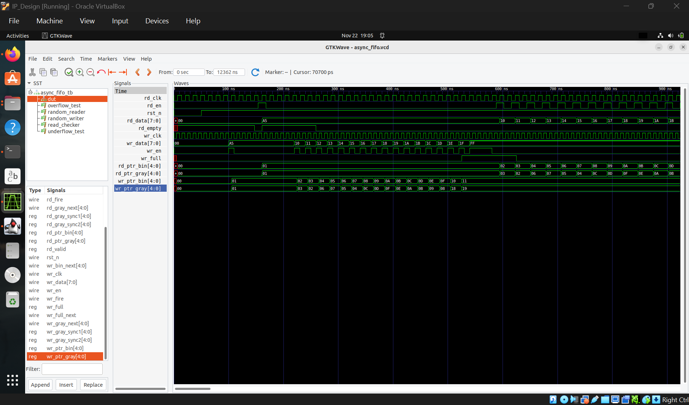
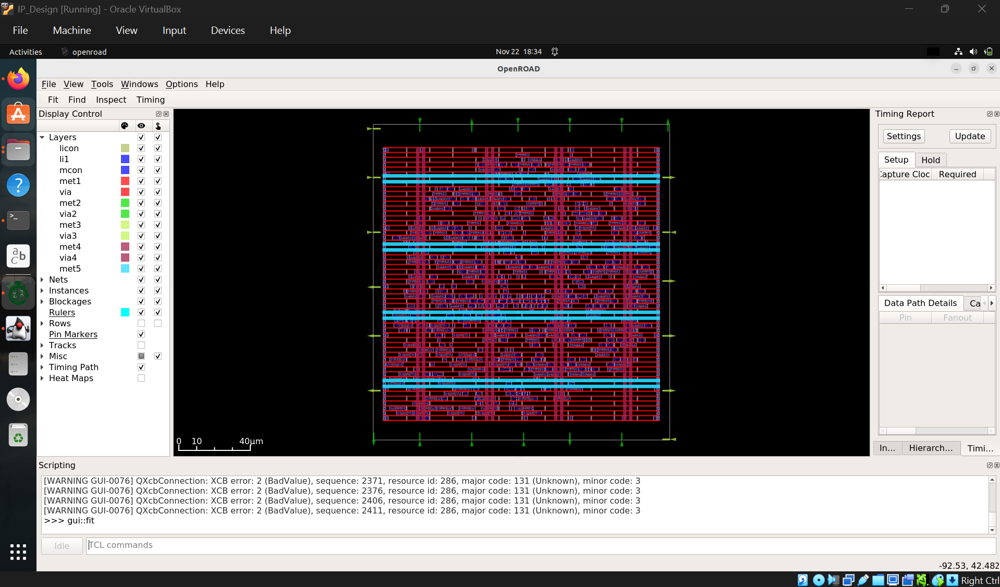
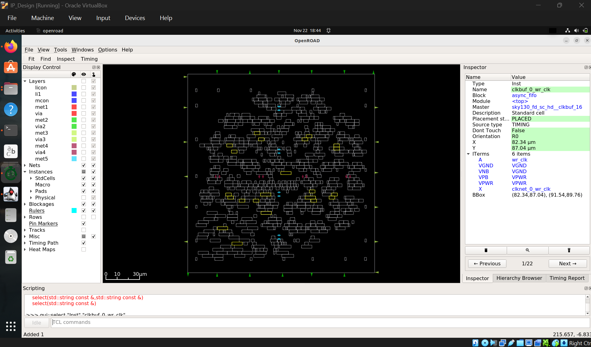
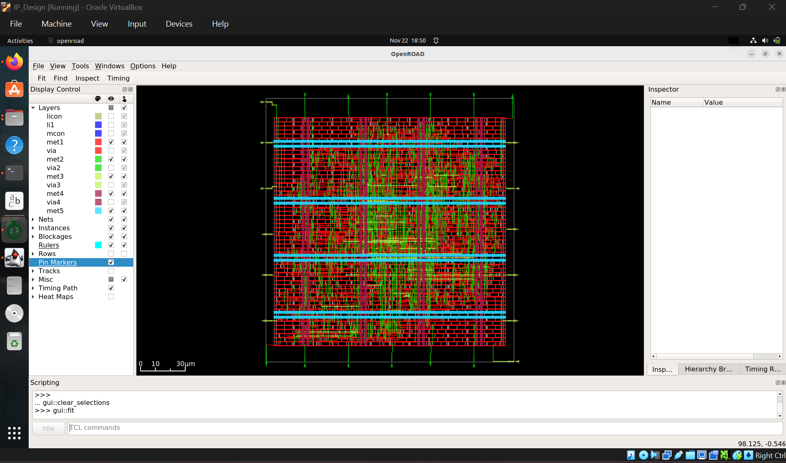
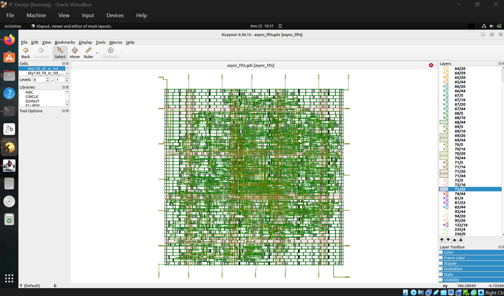

# Asynchronous FIFO — RTL Design, Verification & RTL-to-GDSII Implementation

A parameterized dual-clock asynchronous FIFO designed in Verilog, verified using a self-checking SystemVerilog testbench, and physically implemented using OpenLane Classic with the Sky130A open-source PDK.

The project demonstrates clock-domain crossing (CDC), Gray-code pointer synchronization, FIFO control logic, functional verification, and the complete ASIC physical-design workflow from RTL synthesis to GDSII generation.

## 1. Project Overview

An asynchronous FIFO transfers data between two independent clock domains.

Unlike a synchronous FIFO, the write and read operations are controlled by separate clocks that may operate at different frequencies and phases.

The design uses Gray-coded pointers and two-stage synchronizers to communicate FIFO occupancy information across clock domains.

### Key Features

- Parameterized FIFO data width and address width
- Default configuration: 16 entries × 8 bits
- Independent write and read clocks
- Binary pointers for memory addressing
- Gray-coded pointers for CDC
- Two-stage pointer synchronizers in both directions
- Registered full and empty flags
- Read-valid output
- Overflow and underflow protection
- Active-low asynchronous reset
- Self-checking SystemVerilog verification environment
- Sky130A standard-cell physical implementation

## 2. FIFO Specifications

| Parameter | Value |
|---|---|
| Top module | `async_fifo` |
| Data width | 8 bits |
| Address width | 4 bits |
| FIFO depth | 16 entries |
| Pointer width | 5 bits |
| Storage capacity | 128 bits |
| Write clock | `wr_clk` |
| Read clock | `rd_clk` |
| Reset | `rst_n`, active-low |
| Write enable | `wr_en` |
| Read enable | `rd_en` |
| Full flag | `wr_full` |
| Empty flag | `rd_empty` |
| Read-valid flag | `rd_valid` |

## 3. Architecture

The asynchronous FIFO consists of:

**Write domain**
- Write binary pointer
- Write Gray-code pointer
- Full detection logic
- Read-pointer synchronizer

**Read domain**
- Read binary pointer
- Read Gray-code pointer
- Empty detection logic
- Write-pointer synchronizer

**Shared storage**
- 16 × 8-bit FIFO memory
- Write operation controlled by `wr_clk`
- Read operation controlled by `rd_clk`

### Write Operation

A write is accepted when:

`wr_fire = wr_en && !wr_full`

At the active write-clock edge, the input data is stored at the address selected by the binary write pointer.

The pointer advances only for an accepted write.

### Read Operation

A read is accepted when:

`rd_fire = rd_en && !rd_empty`

At the active read-clock edge, the oldest FIFO entry is read into `rd_data`.

The registered `rd_valid` output indicates a successful read.

## 4. Clock-Domain Crossing and Synchronization

The write and read domains operate independently.

Directly transferring a multi-bit binary pointer between asynchronous clock domains can cause incorrect sampling when multiple pointer bits change simultaneously.

This design uses Gray-coded pointers, where consecutive pointer values differ by only one bit.

### Binary-to-Gray Conversion

`gray = binary ^ (binary >> 1)`

### Synchronization

Each Gray-coded pointer crosses into the opposite clock domain through a two-stage flip-flop synchronizer.

**Read pointer to write domain:**

`rd_ptr_gray → rd_gray_sync1 → rd_gray_sync2 → full detection`

Both synchronizer stages use `wr_clk`.

**Write pointer to read domain:**

`wr_ptr_gray → wr_gray_sync1 → wr_gray_sync2 → empty detection`

Both synchronizer stages use `rd_clk`.

The synchronizers reduce the probability of metastability propagating into the destination-domain control logic.

They do not eliminate metastability, and CDC signoff additionally requires appropriate physical constraints and reset-domain analysis.

## 5. Full and Empty Detection

### Empty Detection

The FIFO is considered empty in the read domain when the next read Gray pointer equals the synchronized write Gray pointer.

`rd_gray_next == wr_gray_sync2`

### Full Detection

The FIFO is considered full in the write domain when the next write Gray pointer equals the synchronized read Gray pointer with its two most significant bits inverted.

`wr_gray_next == {~rd_gray_sync2[PTR_WIDTH-1:PTR_WIDTH-2], rd_gray_sync2[PTR_WIDTH-3:0]}`

The extra pointer bit distinguishes full from empty after address wraparound.

## 6. Functional Verification

A self-checking SystemVerilog testbench was developed to verify the FIFO's behavior.

### Verification Features

- Independent scoreboard for data integrity
- Automatic expected-versus-actual read comparisons
- Read-valid checking
- Reset verification
- Single write/read testing
- Full detection
- Overflow rejection
- Empty detection
- Underflow rejection
- FIFO ordering checks
- Randomized concurrent write/read traffic
- Automatic pass/fail reporting
- Simulation timeout protection

### Testbench Configuration

| Parameter | Value |
|---|---|
| Write clock period | 10 ns |
| Read clock period | 14 ns |
| Write clock frequency | 100 MHz |
| Read clock frequency | Approximately 71.43 MHz |
| Random transactions | 200 |
| Scoreboard capacity | 1024 entries |

The testbench records accepted write data in an independent scoreboard and compares accepted reads against the expected sequence.

### Run RTL Simulation

Requirements: Icarus Verilog and GTKWave.

```bash
iverilog -g2012 -s async_fifo_tb -o async_fifo_sim RTL/async_fifo.v TB/async_fifo_tb.sv
vvp async_fifo_sim
gtkwave async_fifo.vcd
```

A successful test run reports `ALL TESTS PASSED`.

### Verification Limitations

The testbench verifies digital functional behavior but does not model analog metastability.

Further verification should include multiple clock ratios, reset during active traffic, CDC structural checks, functional coverage, and gate-level timing analysis.

## 7. RTL-to-GDSII Implementation

The design was physically implemented using OpenLane Classic v1.0.2 and the Sky130A PDK.

### Technology and Tools

| Tool | Purpose |
|---|---|
| Verilog | RTL design |
| SystemVerilog | Functional verification |
| Icarus Verilog | RTL simulation |
| GTKWave | Waveform inspection |
| Yosys | Logic synthesis |
| ABC | Logic optimization and mapping |
| OpenLane Classic | ASIC implementation flow |
| OpenROAD | Placement, CTS, routing and physical optimization |
| OpenSTA | Static timing analysis |
| Magic | Layout generation and DRC |
| Netgen | Layout-versus-schematic checking |
| KLayout | GDSII visualization and comparison |
| Sky130A | Target process design kit |

### Physical Design Stages

1. RTL synthesis and technology mapping
2. Floorplanning
3. Power distribution network generation
4. Global and detailed placement
5. Clock tree synthesis
6. Timing-driven optimization
7. Global routing
8. Detailed routing
9. Parasitic extraction
10. Static timing analysis
11. DRC and LVS
12. Antenna checks
13. GDSII generation

### OpenLane Configuration

- PDK: `sky130A`
- Standard-cell library: `sky130_fd_sc_hd`
- Clock-period configuration: 20 ns
- Target floorplan core utilization: 35%
- Synthesis strategy: `AREA 0`

The two FIFO clocks are independent by design. Equal clock-period constraints do not imply a synchronous relationship.

## 8. Physical Design Results

Results from OpenLane run `FIFO_FULL_FLOW_01`.

| Metric | Reported Value |
|---|---|
| Flow status | Completed |
| Synthesis cell count | 705 |
| Final total cell count | 3,500 |
| Die area | 0.029149 mm² |
| Core area | 23,472.512 µm² |
| OpenDP utilization | 36.84% |
| Total wire length | 23,469 µm |
| Total vias | 6,442 |
| Worst negative slack | 0 ns |
| Total negative slack | 0 ns |
| Reported critical path | 2.72 ns |
| Detailed-routing violations | 0 |
| Magic DRC violations | 0 |
| LVS errors | 0 |
| Pin antenna violations | 0 |
| Net antenna violations | 0 |
| Full-flow runtime | 3 minutes 27 seconds |

The metrics represent the recorded OpenLane implementation and its configured timing analysis. They do not establish a maximum CDC-safe clock frequency or complete multi-corner signoff.

## 9. Physical Design Outputs

The repository includes the final GDSII layout, OpenLane configuration, metrics, and selected verification reports.

The final GDSII can be opened using KLayout:

```bash
klayout Results/async_fifo.gds
```

The design was successfully opened and inspected in KLayout.

## 10. Repository Structure

```text
Asynchronous-FIFO-RTL-to-GDSII/
├── README.md
├── RTL/
│   └── async_fifo.v
├── TB/
│   └── async_fifo_tb.sv
├── OpenLane/
│   ├── config.tcl
│   ├── timing/
│   └── metrics.csv
├── Reports/
│   ├── drc.rpt
│   ├── lvs.rpt
│   ├── timing_summary.rpt
│   └── power.rpt
├── Results/
│   └── async_fifo.gds
└── Images/
```

## 11. Key Learning Outcomes

- Designing asynchronous FIFOs with independent read/write clocks
- Understanding metastability and clock-domain crossing
- Using Gray-coded pointers and two-stage synchronizers
- Implementing full and empty detection with wraparound pointers
- Building a self-checking SystemVerilog scoreboard
- Verifying FIFO overflow, underflow, ordering, and concurrent traffic
- Understanding RTL synthesis and standard-cell technology mapping
- Performing floorplanning, placement, CTS, and routing
- Interpreting timing, utilization, DRC, LVS, and routing reports
- Generating and inspecting GDSII layouts

## 12. Future Improvements

- CDC structural verification and Gray-bus timing constraints
- Reset-deassertion synchronization in both domains
- SystemVerilog Assertions (SVA)
- Functional coverage and expanded randomized testing
- Multiple independent clock-frequency configurations
- Gate-level simulation with timing annotation
- Multi-corner timing analysis
- Further physical-design optimization

## 13. Project Status

**Completed:** RTL design, self-checking functional verification, OpenLane physical implementation, and final GDSII generation.

**Additional signoff recommended:** CDC-specific constraints and analysis, reset-domain verification, and expanded timing/verification coverage.

This project is an educational ASIC implementation and has not been fabricated in silicon.


## RTL Verification & Physical Design Gallery

The asynchronous FIFO was verified using Icarus Verilog and GTKWave, followed by an RTL-to-GDSII implementation using OpenLane and the Sky130 standard-cell library.

### 1. RTL Functional Verification

The SystemVerilog testbench verifies FIFO write/read operations, data integrity, and full/empty flag behavior across independent write and read clock domains.



### 2. Standard-Cell Placement

Placement of the synthesized asynchronous FIFO standard cells within the core area using OpenROAD.



### 3. Clock Tree Synthesis (CTS)

Clock Tree Synthesis was performed for the independent write and read clock domains.

- Write-clock CTS buffers: **17**
- Read-clock CTS buffers: **5**
- Total explicitly identified CTS buffers: **22**

The highlighted cells represent CTS-inserted clock buffers for the two clock domains.



### 4. Detailed Routing

Physical routing of the FIFO design, showing metal interconnections across the Sky130 routing layers.



### 5. Final GDSII Layout

Final GDSII layout generated through the OpenLane RTL-to-GDSII flow and visualized using KLayout.



### Physical Verification

The completed OpenLane flow generated timing, DRC, and LVS reports, available in the `Reports/` directory.

The final GDSII file is available at:

`Results/async_fifo.gds`

### Tools and Technology

- **RTL:** Verilog
- **Verification:** SystemVerilog, Icarus Verilog, GTKWave
- **Synthesis:** Yosys
- **Physical Design:** OpenLane, OpenROAD
- **Technology:** SkyWater SKY130 (`sky130_fd_sc_hd`)
- **GDSII Visualization:** KLayout

